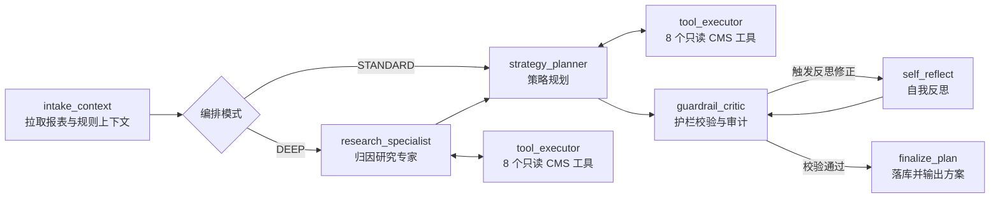

# AFS CMS & AdOps Agent

基于 **JDK 17 + Spring Boot 2.7 + LangChain4j 1.0.1 + LangGraph4j 1.5.14 + React 18 / TypeScript** 构建的海外广告投放管理后台（CMS）与多智能体（AdOps Agent）投放优化平台。

单进程集成了广告投放 CMS、开放数据 API、管理控制台以及基于编译态 `StateGraph` 的多智能体分析工作台，默认支持零外部依赖的本地 H2 运行模式，同时兼容 MySQL / Redis / 多渠道投放连接器部署。

---

## 核心特性

### 1. 智能体工作台（LangGraph4j + LangChain4j）
- **双模式状态图编排**：基于 LangGraph4j 编译态 `StateGraph` 与 JDBC 检查点持久化（`agent_checkpoint`），支持：
  - **标准 ReAct 图（`STANDARD`）**：`intake_context → strategy_planner ⇄ tool_executor → guardrail_critic ⇄ self_reflect → finalize_plan`
  - **深度多智能体协作图（`DEEP`）**：`intake_context → research_specialist ⇄ tool_executor → strategy_planner ⇄ tool_executor → guardrail_critic ⇄ self_reflect → finalize_plan`
- **8 个只读 CMS 工具调用**：自动查询逐日报表、国家/地区拆分、创意与落地页上下文、绑定规则、同业基准、历史分析记录、预算试算与场景目录。
- **硬性护栏与人工审批闭环**：内置 `guardrail_critic → self_reflect` 反思修正循环；渠道未配置、样本不足或规则缺失时自动拦截放量建议；支持审批流（含可选的双人 `operator` / `reviewer` 分权审批）与预算试算。
- **AI 投放副驾驶（Copilot）**：支持多轮对话与 SQL 持久化记忆，实时调用业务数据工具完成全盘复盘、活动深挖并一键发起审批工单。
- **全盘异常巡检**：一键扫描在投活动的严重亏损、低 ROAS、放量机会及规则护栏缺口。
- **流式可观测性**：通过 SSE（Server-Sent Events）实时推送图节点进度、工具调用链路、Token 消耗与耗时分布，支持主备模型自动故障转移及离线规则降级。

### 2. 广告投放 CMS 与管理控制台
- **多渠道投放管理**：支持常规广告活动与 TikTok / Meta / Taboola / Google Ads / AdSense 等多渠道报表查询、活动审核、规则绑定与归档。
- **内容与素材管理**：文章发布、广告素材与文案管理、分类维护及本地文件上传。
- **安全凭据管理**：渠道密钥与 AI 平台凭据采用 AES-GCM 加密落库，密钥文件与业务库隔离存放；不硬编码任何真实密钥。
- **一体化打包**：React + TypeScript + Vite 前端构建产物内置于 Spring Boot JAR 中，无需单独启动 Node 服务。

---

## 智能体编排架构



---

## 技术栈

| 层级 | 技术选型 |
| --- | --- |
| 后端框架 | Java 17, Spring Boot 2.7.0, Spring Security, MyBatis 2.2.2, Spring Data JDBC |
| AI / Agent | LangChain4j 1.0.1, LangGraph4j 1.5.14 (`langgraph4j-core`, `langgraph4j-langchain4j`) |
| 数据存储 | H2（本地一体化 / 模拟模式）, MySQL, Redis |
| 前端技术 | React 18, TypeScript 5.6, Vite 5.4 |
| 外部集成（可选） | OpenAI 兼容 LLM 接口, Google Ads / AdSense, Meta, TikTok, Taboola, Cloudflare, Aliyun OSS |

---

## 项目结构

```text
afs-cms/
├── frontend/                   # React + TypeScript + Vite 控制台源码
├── src/
│   ├── main/
│   │   ├── java/com/afs/
│   │   │   ├── agent/          # LangGraph4j / LangChain4j 智能体编排、工具、护栏、Copilot 与可观测性
│   │   │   ├── controller/     # CMS 业务与控制台接口
│   │   │   ├── publicapi/      # 开放数据与上报 API (/api/**)
│   │   │   ├── service/        # 渠道数据同步、报表与连接器服务
│   │   │   └── dao/            # MyBatis Mapper 与数据模型
│   │   └── resources/          # Spring 配置、H2 Schema、静态控制台产物与模拟样例
│   └── test/                   # 单元测试与智能体集成测试
├── sql/                        # MySQL 建表与迁移脚本
├── tools/                      # 历史日志与归档数据导入脚本 (Python)
├── Run-LocalCms.ps1            # Windows 本地一体化启动脚本 (端口 9901)
├── Run-AgentSimulation.ps1     # Windows 独立智能体模拟启动脚本 (端口 9903)
├── AGENT-SIMULATION.md         # 智能体架构与模拟模式详细说明
└── 使用手册.md                  # 本地管理台完整使用手册
```

---

## 快速开始

### 环境要求
- **JDK 17**
- **Maven 3.8+**
- *(可选，仅二次开发前端时需要)* **Node.js 18+**

### 1. 构建项目

```bash
mvn clean package -DskipTests
```

*(如需重新构建前端静态资源：)*

```bash
cd frontend
npm install
npm run build
```

### 2. 启动本地一体化模式（默认 `local-cms`，端口 `9901`）

```bash
java -jar target/afs-cms.jar --spring.profiles.active=local-cms
```

Windows PowerShell 也可直接运行（支持追加 `-SeedDemo` 写入演示数据）：

```powershell
.\Run-LocalCms.ps1 -SeedDemo
```

不想看到任何黑窗口时，用后台方式启动（`javaw.exe` + 隐藏窗口，进程与终端完全脱钩，日志写入 `./log`）：

```powershell
# 方式一：双击即可，无需开启脚本执行策略
Start-LocalCms.vbs

# 方式二：命令行，需要绕过执行策略
powershell -NoProfile -ExecutionPolicy Bypass -File .\Run-LocalCms.ps1 -Background
```

后台启动后，`log\start.log` 记录每次启动结果（`STARTED` / `SKIP` / `FAIL`），重复启动会检测 9901 已监听并直接跳过。停止服务：

```powershell
Get-CimInstance Win32_Process -Filter "Name='javaw.exe'" |
    Where-Object { $_.CommandLine -like '*afs-cms.jar*' } |
    ForEach-Object { Stop-Process -Id $_.ProcessId -Force }
```

本地工作区默认由 `RealisticPlatformDataMigration` 与 `RealisticWorkspaceExpansion` 两个可重复执行的迁移填充，开关是 `afs.workspace.realistic-data`（`local-cms` 配置里打开，测试环境默认关闭，避免污染内存库）：

- **32 个站点 / 640 条活动**：站点标识来自 `SiteController.sites()`，每个站点一个独立垂类（家居健身、智能安防、旅行卡、装修、牙科、保险、隐私安全等），每个垂类 5 个子主题、20 条活动；活动名按账号内序号编号（`TT_US_FoldableTreadmill_RSOC_07`）。
- **时间跨度 2023-03 至今**：每个活动有自己的投放窗口（约 30–70 天），窗口起点分布在 2023-03 到 2026-10 之间，约 40% 的活动仍在投放（PASS 256 / ARCHIVE 320 / AUDITING 32 / REJECT 32）。报表、维护页、关键词快照、审批记录都能查到 2023 年以来的日期（`adsense_data` 覆盖 1341 个自然日）；活动创建时间、文章/素材发布时间、审批时间都落在各自窗口上，不再是同一天的批量数据。
- **市场按垂类分配，不再全站同款**：高客单服务类（种植牙、保险、法律、养老、装修）只买 US/GB/CA/AU/IE；消费品类加 NZ/SG；内容套利类（生活、清洁、居家安全）才带 IN/PH/ZA 的 Tier-3 量。全库市场分布 US 228 / GB 113 / CA 103 / AU 93 / DE 24 / FR 24 / IE 17 / IN 12 / SG 10 / NZ 7 / PH 6 / ZA 3，CPM 随梯队走（Tier 1 约 8–9，Tier 2 约 5–6，Tier 3 约 2）。
- **内容不重复且按内容类型分语法**：640 篇文章标题互不相同，四种「波次」对应四种文章形态（原始评测、价格清单、横向对比、90 天复盘）；产品类用「N Picks Under $X / N Models Tested」，服务类用「Real Prices / N Providers Compared」，观点类用「How to Choose / N Approaches」。生成器 `ContentLibrary` 按「对比 / 清单 / 预算 / 实测 / 复盘 / 踩坑 / 区域价格 / 安装」八种编辑角度组织正文，德语、法语站点使用本地语标题与本地语搜索词。
- **素材与文案像素材库**：素材名是资产编号（`tiktok_gb_streaming-mic-setup_9x16_v4`），时长/体积/尺寸按平台规范；广告文案 2–5 行不等，混合钩子、数据佐证与 CTA。
- **投放数据不雷同**：每个站点有独立的质量指数（影响 CPM/CTR/CVR 与 ROAS 基线），每个平台各有 CPM/CTR/CPC 基线；日曲线含周内季节性、预算节奏、素材衰减，少数活动带「中途减预算」、掉量日、单日尖峰，约 100 条活动只有 10–12 天数据（中途上线）。
- **反馈跟随站点市场**：每个站点 2–6 条评价，locale 取自该站点实际投放的市场（`en-IN`、`de-DE` 等），不会给 US-only 站点塞德语评价；重复运行迁移会先按评价正文清理旧种子数据，不会越跑越多。
- **保留人工数据**：迁移只覆盖种子语料（`article_id LIKE 'afs-article-%' AND partner = 'AFS Media'`），手工新建的活动、文章、素材、规则、用户不会被改写；`channel_credential`、导入的历史归档数据同样保留。
- **每个渠道都有报表配置**：`RealisticReportConfigs` 会按活动所属文章补齐 `report_data_config`（每个渠道一行，幂等），否则智能体的渠道校验会判定「报表渠道未配置」，把模型建议一律压回 HOLD。

启动后访问控制台：<http://127.0.0.1:9901/console>
- 默认本地账号：`local-admin`
- 首次启动会自动生成本地签名密钥文件 `data/local-admin.key`，将其内容粘贴至登录页「CMS 签名密钥」即可登录。

### 3. 启动独立智能体模拟模式（`agent-sim`，端口 `9903`）

```bash
java -jar target/afs-cms.jar --spring.profiles.active=agent-sim
```

访问 <http://127.0.0.1:9903/> 即可在隔离的合成数据环境下体验智能体分析、审批与预算试算。

---

## 环境变量配置（按需配置）

项目默认零外部凭据即可在本地运行。接入真实 LLM 或生产数据库/渠道时，请通过环境变量或在控制台「渠道密钥」页面配置：

| 环境变量 | 说明 |
| --- | --- |
| `AFS_AGENT_AI_BASE_URL` | OpenAI 兼容接口 Base URL（如 `https://api.openai.com/v1`） |
| `AFS_AGENT_AI_API_KEY` | AI 平台 API Key |
| `AFS_AGENT_AI_MODEL` | 主聊天模型名称 |
| `AFS_AGENT_AI_TIMEOUT_SECONDS` | 单次模型调用超时时间（秒，默认 `90`） |
| `AFS_DB_URL` / `AFS_DB_USERNAME` / `AFS_DB_PASSWORD` | MySQL 数据库连接配置（`dev/test/preview/prod` Profile 使用） |
| `AFS_META_ACCESS_TOKEN` / `AFS_TIKTOK_ACCESS_TOKEN` | Meta / TikTok 投放数据拉取凭据 |
| `AFS_CLOUDFLARE_API_TOKEN` / `AFS_CLOUDFLARE_AUTH_EMAIL` / `AFS_CLOUDFLARE_ZONE_MAP` | Cloudflare 缓存清理配置 |
| `AFS_FEISHU_AUDIT_WEBHOOK` / `AFS_FEISHU_ERROR_WEBHOOK` / `AFS_FEISHU_DAILY_WEBHOOK` | 飞书告警与日报 Webhook |
| `CMS_AGENT_REQUIRE_STAFF_LOGIN` / `CMS_AGENT_OPERATOR_PASSWORD` / `CMS_AGENT_REVIEWER_PASSWORD` | 开启双人审批鉴权（`operator` / `reviewer`） |

---

## 海外运营模块的数据与执行方式

运营总览新增归因队列、账户快照和落地页观测入口，均可下载 CSV 表头后导入。归因队列按 `campaignId + cohortDate + ageDay` 保存累计收入；重复观测替换，累计收入不重复求和，未观测的 D7/D30 留空。覆盖至少 3 个年龄且到 D7 后，才尝试对累计收入作对数趋势拟合；预测单列显示，拟合不足不输出预测。

汇率在「录入汇率」中填写日期、来源和 1 USD 对应目标币种数量。换算只影响展示，未录入的币种显示缺少汇率，不使用固定默认值。账户余额、拒登和账户状态来自导入快照，过期快照会标记；落地页 TTFB/CVR 来源于按活动和日期导入的观测。

多语言生成使用「渠道密钥」中保存的 AI 聊天配置；配置缺失或生成失败会返回错误，不用模板冒充生成。合规雷达区分 AI 辅助检查与关键词筛查，不能保证平台过审。

规则页支持下拉编辑、数字阈值、报告时区、低峰时段和预算上限。定时评估默认关闭，开启后每分钟检查；同一规则/活动每天最多触发一次。仅有当日平台观测才评估。本地执行只更新本地 TikTok 广告组记录，其他平台和素材轮换记录为待人工处理；不会创建外部投放请求。日志区分试算、本地更新、待人工处理、无变更与失败。

创意工坊的实验看板读取实际导入的各组日报，A 为对照组，B/C 等为实验组，支持多组比较。CTR 双样本检验采用 Bonferroni 校正，周期不一致或样本不足不判胜。流量分配仍须在广告平台或站点实验工具配置；登记草稿不会自动分流。

以上新增导入和规则修改接口使用现有签名鉴权，并要求管理员权限。启动和测试不需要真实第三方凭据。

## 更多文档

- [使用手册.md](./使用手册.md)：本地管理台功能导航、常用投放流程、智能体使用指南与常见问题。
- [AGENT-SIMULATION.md](./AGENT-SIMULATION.md)：智能体状态图细节、API 调试示例与归档数据导入说明。
- [简历版说明.md](./简历版说明.md)：面向简历与作品集的项目说明（架构、职责、技术亮点、演示脚本）。
- [docs/interview/](./docs/interview/README.md)：面试材料全套（事实卡、简历模板、STAR 话术、问答集、八股文、手撕题、模拟面试、投递 checklist）。
