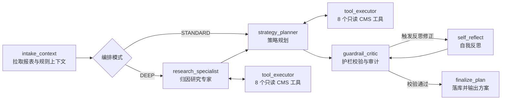

# AFS CMS & AdOps Agent

基于 **JDK 17 + Spring Boot 2.7 + LangChain4j 1.0.1 + LangGraph4j 1.5.14 + React 18 / TypeScript** 构建的海外广告投放管理后台（CMS）与多智能体（AdOps Agent）投放优化平台。

单进程集成了广告投放 CMS、开放数据 API、管理控制台以及基于编译态 `StateGraph` 的多智能体分析工作台，默认支持零外部依赖的本地 H2 运行模式，同时兼容 MySQL / Redis / 多渠道投放连接器部署。

---

## 核心特性

### 1. 智能体工作台（LangGraph4j + LangChain4j）
- **双模式状态图编排**：基于 LangGraph4j 编译态 `StateGraph` 与 JDBC 检查点持久化（`agent_checkpoint`），支持：
  - **标准 ReAct 图（`STANDARD`）**：`intake_context → strategy_planner ⇄ tool_executor → guardrail_critic ⇄ self_reflect → finalize_plan`
  - **深度多智能体协作图（`DEEP`）**：`intake_context → research_specialist ⇄ tool_executor → strategy_planner ⇄ tool_executor → guardrail_critic ⇄ self_reflect → finalize_plan`
- **8 个只读 CMS 工具调用**：自动查询逐日报表、国家/地区拆分、创意与落地页上下文、绑定规则、同业基准、历史分析记录、预算试算与场景目录。
- **硬性护栏与人工审批闭环**：内置 `guardrail_critic → self_reflect` 反思修正循环；渠道未配置、样本不足或规则缺失时自动拦截放量建议；支持审批流（含可选的双人 `operator` / `reviewer` 分权审批）与预算试算。
- **AI 投放副驾驶（Copilot）**：支持多轮对话与 SQL 持久化记忆，实时调用业务数据工具完成全盘复盘、活动深挖并一键发起审批工单。
- **全盘异常巡检**：一键扫描在投活动的严重亏损、低 ROAS、放量机会及规则护栏缺口。
- **流式可观测性**：通过 SSE（Server-Sent Events）实时推送图节点进度、工具调用链路、Token 消耗与耗时分布，支持主备模型自动故障转移及离线规则降级。

### 2. 广告投放 CMS 与管理控制台
- **多渠道投放管理**：支持常规广告活动与 TikTok / Meta / Taboola / Google Ads / AdSense 等多渠道报表查询、活动审核、规则绑定与归档。
- **内容与素材管理**：文章发布、广告素材与文案管理、分类维护及本地文件上传。
- **安全凭据管理**：渠道密钥与 AI 平台凭据采用 AES-GCM 加密落库，密钥文件与业务库隔离存放；不硬编码任何真实密钥。
- **一体化打包**：React + TypeScript + Vite 前端构建产物内置于 Spring Boot JAR 中，无需单独启动 Node 服务。

---

## 智能体编排架构



---

## 技术栈

| 层级 | 技术选型 |
| --- | --- |
| 后端框架 | Java 17, Spring Boot 2.7.0, Spring Security, MyBatis 2.2.2, Spring Data JDBC |
| AI / Agent | LangChain4j 1.0.1, LangGraph4j 1.5.14 (`langgraph4j-core`, `langgraph4j-langchain4j`) |
| 数据存储 | H2（本地一体化 / 模拟模式）, MySQL, Redis |
| 前端技术 | React 18, TypeScript 5.6, Vite 5.4 |
| 外部集成（可选） | OpenAI 兼容 LLM 接口, Google Ads / AdSense, Meta, TikTok, Taboola, Cloudflare, Aliyun OSS |

---

## 项目结构

```text
afs-cms/
├── frontend/                   # React + TypeScript + Vite 控制台源码
├── src/
│   ├── main/
│   │   ├── java/com/afs/
│   │   │   ├── agent/          # LangGraph4j / LangChain4j 智能体编排、工具、护栏、Copilot 与可观测性
│   │   │   ├── controller/     # CMS 业务与控制台接口
│   │   │   ├── publicapi/      # 开放数据与上报 API (/api/**)
│   │   │   ├── service/        # 渠道数据同步、报表与连接器服务
│   │   │   └── dao/            # MyBatis Mapper 与数据模型
│   │   └── resources/          # Spring 配置、H2 Schema、静态控制台产物与模拟样例
│   └── test/                   # 单元测试与智能体集成测试
├── sql/                        # MySQL 建表与迁移脚本
├── tools/                      # 历史日志与归档数据导入脚本 (Python)
├── Run-LocalCms.ps1            # Windows 本地一体化启动脚本 (端口 9901)
├── Run-AgentSimulation.ps1     # Windows 独立智能体模拟启动脚本 (端口 9903)
├── AGENT-SIMULATION.md         # 智能体架构与模拟模式详细说明
└── 使用手册.md                  # 本地管理台完整使用手册
```

---

## 快速开始

### 环境要求
- **JDK 17**
- **Maven 3.8+**
- *(可选，仅二次开发前端时需要)* **Node.js 18+**

### 1. 构建项目

```bash
mvn clean package -DskipTests
```

*(如需重新构建前端静态资源：)*

```bash
cd frontend
npm install
npm run build
```

### 2. 启动本地一体化模式（默认 `local-cms`，端口 `9901`）

```bash
java -jar target/afs-cms.jar --spring.profiles.active=local-cms
```

Windows PowerShell 也可直接运行（支持追加 `-SeedDemo` 写入演示数据）：

```powershell
.\Run-LocalCms.ps1 -SeedDemo
```

启动后访问控制台：<http://127.0.0.1:9901/console>
- 默认本地账号：`local-admin`
- 首次启动会自动生成本地签名密钥文件 `data/local-admin.key`，将其内容粘贴至登录页「CMS 签名密钥」即可登录。

### 3. 启动独立智能体模拟模式（`agent-sim`，端口 `9903`）

```bash
java -jar target/afs-cms.jar --spring.profiles.active=agent-sim
```

访问 <http://127.0.0.1:9903/> 即可在隔离的合成数据环境下体验智能体分析、审批与预算试算。

---

## 环境变量配置（按需配置）

项目默认零外部凭据即可在本地运行。接入真实 LLM 或生产数据库/渠道时，请通过环境变量或在控制台「渠道密钥」页面配置：

| 环境变量 | 说明 |
| --- | --- |
| `AFS_AGENT_AI_BASE_URL` | OpenAI 兼容接口 Base URL（如 `https://api.openai.com/v1`） |
| `AFS_AGENT_AI_API_KEY` | AI 平台 API Key |
| `AFS_AGENT_AI_MODEL` | 主聊天模型名称 |
| `AFS_AGENT_AI_TIMEOUT_SECONDS` | 单次模型调用超时时间（秒，默认 `90`） |
| `AFS_DB_URL` / `AFS_DB_USERNAME` / `AFS_DB_PASSWORD` | MySQL 数据库连接配置（`dev/test/preview/prod` Profile 使用） |
| `AFS_META_ACCESS_TOKEN` / `AFS_TIKTOK_ACCESS_TOKEN` | Meta / TikTok 投放数据拉取凭据 |
| `AFS_CLOUDFLARE_API_TOKEN` / `AFS_CLOUDFLARE_AUTH_EMAIL` / `AFS_CLOUDFLARE_ZONE_MAP` | Cloudflare 缓存清理配置 |
| `AFS_FEISHU_AUDIT_WEBHOOK` / `AFS_FEISHU_ERROR_WEBHOOK` / `AFS_FEISHU_DAILY_WEBHOOK` | 飞书告警与日报 Webhook |
| `CMS_AGENT_REQUIRE_STAFF_LOGIN` / `CMS_AGENT_OPERATOR_PASSWORD` / `CMS_AGENT_REVIEWER_PASSWORD` | 开启双人审批鉴权（`operator` / `reviewer`） |

---

## 更多文档

- [使用手册.md](./使用手册.md)：本地管理台功能导航、常用投放流程、智能体使用指南与常见问题。
- [AGENT-SIMULATION.md](./AGENT-SIMULATION.md)：智能体状态图细节、API 调试示例与归档数据导入说明。
