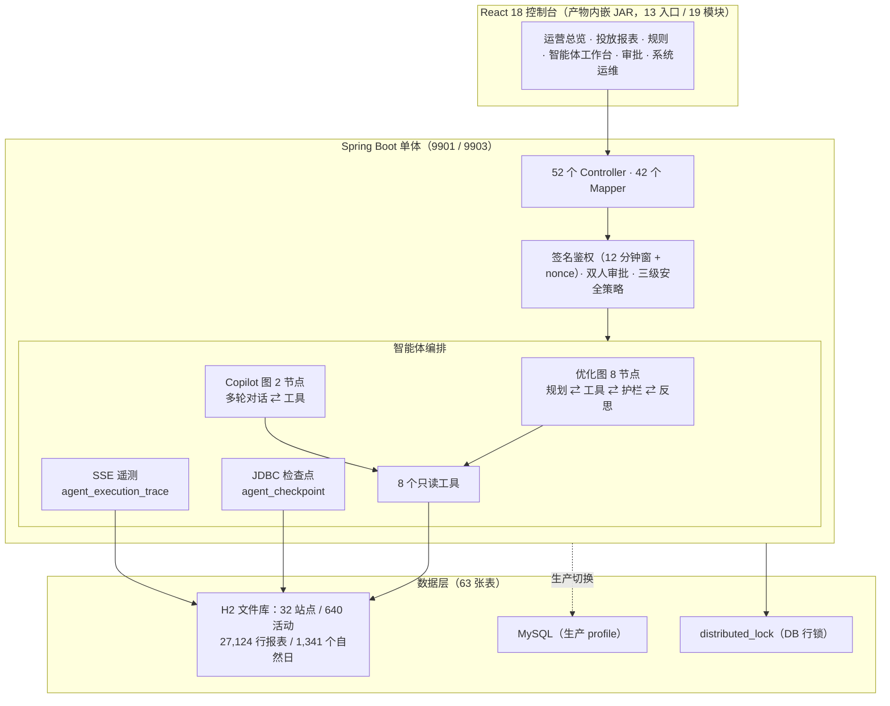

# 广告投放管理平台与多智能体优化系统

> **一句话**：一个能本地一键跑起来、把「AI 建议」变成「可验证、可拦截、可审计的投放方案」的广告投放中台。
>
> **不是 Demo 的证据**：31 个测试用例全绿；本地工作区已真实跑过 **78 次优化运行、461 个节点执行、
> 395 次工具调用、127 万 token**；库里 **640 个活动**的真实数据。
>
> Java 17 · Spring Boot 2.7 · MyBatis · LangGraph4j 1.5.14 · LangChain4j 1.0.1 · H2 / MySQL · React 18 + TypeScript
>
> 个人项目 · 可现场演示 · 零外部凭据启动 · 冷启动 8.5 秒

---

## 1. 为什么做这个

广告投放的日常是这样的：运营早上打开 4 个平台后台，把昨天的花费、ROAS、CPA 抄进表格，
发现某个国家在亏钱，凭经验把预算砍 20%；下午看数据又觉得砍多了，加回来 15%。

三个真问题：

1. **决策靠人肉**——跨平台数据在 4 个后台，对齐口径要一上午；
2. **建议不可审计**——就算接了 AI，运营也没法回答「它凭什么建议我砍这个活动」；
3. **AI 不敢放权**——直接让模型改预算，一次幻觉就是真金白银的损失。

这个项目围绕第 2、3 点展开：**不是让 AI 更聪明，而是让 AI 的错误变得可拦截。**

---

## 2. 系统结构



同一份 JAR 两种形态：`local-cms`（自带 H2 + 合成工作区，零依赖跑通全流程）与
`agent-sim`（隔离的智能体演练环境，不碰任何真实渠道）。

---

## 3. 交付物与规模（全部实测）

| 交付物 | 实测规模 | 说明 |
| --- | --- | --- |
| CMS 后端 | **245** 个主源码文件、**52** 个 Controller、**42** 个 MyBatis Mapper | 活动、报表、内容、素材、规则、审批、开放 API |
| 智能体编排 | **2** 张 LangGraph4j 图（8 节点 / 2 节点）、**8** 个 Function Calling 工具 | 优化闭环 + 多轮 Copilot |
| 数据模型 | **63** 张表；MySQL 迁移脚本 10 个 | H2 `MODE=MySQL` 与 MySQL 同构 |
| 前端 | **19** 个业务模块、**4** 组 **13** 个导航入口 | 内嵌 JAR，无需 Node 运行 |
| 自动化测试 | **10** 个测试类 / **31** 个用例，**0 失败** | 图流转、护栏、检查点重放、鉴权、双人审批、海外运营 |
| 打包产物 | **194 MB** fat jar，冷启动 **8.54 秒** | `java -jar` 一条命令 |

### 工作区数据（`SELECT` 直接查出来的，不是估算）

| 项 | 值 |
| --- | --- |
| 活动 | **640**（PASS 256 / ARCHIVE 320 / AUDITING 32 / REJECT 32） |
| 站点 | **32**（每站一个独立垂类，每站 20 个投放位） |
| 报表 | 27,124 行，覆盖 1,341 个自然日（2023-03 起） |
| 文章 / 规则 / 渠道配置 | 842 / 12 / 672 |
| 历史运行 | 78 次优化运行（25 待审批）、461 次节点执行、127 万 token |

---

## 4. 四个技术亮点

### 4.1 把「护栏」做成图里的节点，而不是提示词里的一句话

多数 Agent Demo 的校验写在 Prompt 里（「请勿超过 20%」），模型不听话就完蛋。
这里把校验做成 `guardrail_critic` 节点，对结构化输出做**四类硬校验**：

| 校验 | 规则 |
| --- | --- |
| 枚举 | 动作只能是 `HOLD / REDUCE / INCREASE` |
| 幅度 | `abs(changePercent)` ≤ `min(用户请求, 规则上限, 安全策略)` |
| 符号 | `INCREASE` 必须正、`REDUCE` 必须负、`HOLD` 必须 0 |
| 结构 | 单个合法 JSON，Markdown 围栏自动剥离 |

违规不丢弃也不放行，而是走**反思回环**：把违规原因作为结构化反馈写回 planner 重规划一次
（`MAX_REVISIONS=1`），仍不合规就落回规则基线。

> 效果：模型从「一个会说话的接口」变成「状态机里的一个可验证环节」。

### 4.2 让模型只能看真实数据：8 个只读工具 + 取最小上限

`dailyReport`（≤40 天逐日 + 受众/素材分组）· `countryBreakdown` · `creativeAndLandingContext` ·
`ruleContext` · `peerBenchmarks` · `historicalRuns`（近 5 次审批）· `scenarioCatalog` · `simulateBudget`（只算不写库）

三个细节决定工程质量：

- **取最小上限**：`effectiveLimit = max(0, min(请求幅度, 规则上限))`，再叠安全策略，永远取最保守；
- **输出截断 6500 字符**：长报表不能挤掉护栏规则与历史记忆；
- **异常降级**：工具抛错返回 `{"available": false, "reason": ...}`，图继续跑，而不是整链路 500。

再加一条业务红线：**报表渠道未配置 / 样本不足 / 规则缺失 → 建议直接压回 HOLD**。
宁可不出结论，也不出假结论。

### 4.3 安全治理：三级模式 + 熔断 + 双上限（默认值实测）

```json
{"safetyMode":"COPILOT","killSwitch":false,"dailyBudgetDeltaCap":500.00,
 "maxSingleChangePct":20,"maxLlmCallsPerDay":200,"llmCallsToday":4}
```

| 机制 | 默认 | 作用 |
| --- | --- | --- |
| 安全模式 | `COPILOT` | `SHADOW` 只算不改、`AUTONOMOUS` 才自动执行 |
| Kill Switch | 关闭 | 一键拦截所有写操作（423） |
| 单次调幅 | ±20% | 防把广告平台打回学习期 |
| 日累计变动 | 500 | 按**已提交台账**算实际变动，不按建议算 |
| 日 LLM 调用 | 200 | 防成本失控 |
| 双人审批 | operator / reviewer | 四眼原则，`/runs/*/review` 仅 reviewer |

关键设计：**「今日已用额度」从 `optimization_ledger` 按 `action_type='EXECUTE' AND status='COMMITTED'`
聚合实际变动额**——模型建议 100 次不花钱，只有真正落库执行才占额度。

### 4.4 可观测性：把「Agent 在想什么」变成数据

- 每个节点执行落 `agent_execution_trace`（节点、状态、模型、token、工具数、耗时、摘要）；
- 控制台通过 SSE 订阅 runId，**迟到订阅先回放已发生节点**；
- 断连/超时/异常三处都挂清理，发送失败自动剔除，避免 emitter 泄漏；
- 一次运行结束发 `done`；汇总接口给出节点级平均耗时与 token 分布。

> 这些不是设计图上的功能：库里已经有 **461 条节点轨迹、127 万 token** 的真实记录。

---

## 5. 工程化：让人愿意跑起来

| 做法 | 效果 |
| --- | --- |
| 本地 H2 文件库 + 合成工作区，零外部凭据 | 一条命令起服务，**8.54 秒**可用 |
| 前端产物内嵌 JAR | 部署只有一个文件，不用 Node、不用 Nginx |
| 两个可重复执行的迁移（幂等） | 合成数据可反复重建，不覆盖人工数据 |
| `-Xmx1200m` + 端口检测 + PID 文件 + VBS 后台启动 | 2C4G 小机器可长期常驻 |
| 双人审批按需开启（`@ConditionalOnProperty`） | 本地开发不被打扰，生产才启用 |
| **不用 Redis**：锁用 DB 行锁表，缓存用 60 秒 TTL 字段 | 少一个必须保证一致性的组件 |

---

## 6. 数据说明（必须自己先说，否则被问穿）

本地工作区是**合成的**：32 个站点、640 个活动、覆盖 1341 个自然日，
按垂类分配市场梯队（US/GB/CA/AU 为主，Tier-3 只给内容套利类站点），
每站有独立质量指数影响 CPM/CTR 基线，日曲线带周内季节性、预算节奏、素材衰减。

它的用途是**验证系统在规模与分布上的行为**（护栏拦截、报表聚合正确性、迁移幂等），
**不是**证明真实投放效果。简历与面试中不要把合成 ROAS 写成业务成果。

---

## 7. 三分钟演示脚本（已验证可执行）

1. **起服务**：`Start-LocalCms.vbs` → `http://127.0.0.1:9901/console`
   （登录：`local-admin` + `data/local-admin.key` 内容作为签名密钥）
2. **看规模**：运营总览 → 32 站点 / 640 活动 / 近 30 天消耗与 ROAS
3. **跑一次优化**：选一个亏损活动 → 发起分析 → 右侧看节点逐个亮起
   （`intake_context` → `strategy_planner` → `tool_executor` → `guardrail_critic`）
4. **看护栏**：把预算幅度填成 50% → 提交 → 观察被 `guardrail_critic` 拦下并要求重规划
5. **看审批**：通过后进审批队列 → 切 reviewer → 审批 → 台账记录实际变动
6. **看遥测**：系统运维 → 节点耗时 / token / 工具调用排行（当前 461 条轨迹）

> 环境不允许起服务时，直接打开 `AdOptimizationGraph.java:150-206` 讲图拓扑，
> 打开 `AgentSafetyPolicyService.java:111-132` 讲四道闸——**读代码比看 UI 更有说服力**。

---

## 8. 代码导航

| 想看什么 | 去哪里 |
| --- | --- |
| 图怎么编的 | `src/main/java/com/afs/agent/AdOptimizationGraph.java` |
| 工具怎么定义 | `src/main/java/com/afs/agent/AdvisoryTools.java` |
| 护栏怎么拦 | `AdOptimizationGraph.java` 的 `guardrailCriticNode`（:443-524） |
| 检查点怎么存 | `src/main/java/com/afs/agent/JdbcCheckpointSaver.java` |
| 安全策略 | `src/main/java/com/afs/agent/AgentSafetyPolicyService.java` |
| 双人审批 | `src/main/java/com/afs/agent/StaffSecurity.java` |
| 签名鉴权 | `src/main/java/com/afs/controller/filter/AuthInterceptor.java` |
| 遥测 / SSE | `src/main/java/com/afs/agent/AgentTelemetryService.java` |
| 模型网关 | `src/main/java/com/afs/agent/AiModelGateway.java` |
| 五 Agent 闭环 | `src/main/java/com/afs/agent/FiveAgentOrchestrator.java` |
| 面试全套材料 | `docs/interview/` |

---

## 9. 已知局限与下一步

| 局限 | 下一步 |
| --- | --- |
| 情景记忆是结构化 SQL（近 5 次审批），语义检索缺失 | 引入 embedding 做「相似活动检索」，但先要有评估集 |
| 检查点是整图快照，`state_json` 会随节点增多膨胀 | 改为按节点存 delta + 定期 compaction |
| `evidenceRefs` 是弱约束（提示词 + 人工复核） | 代码级校验：引用必须命中工具返回，否则降级 HOLD |
| 没有真实线上流量做 A/B | 合成数据只能验证正确性，效果验证需影子流量 |
| 签名沿用 MD5（存量契约），nonce 是单机内存态 | 新接口切 HMAC-SHA256，nonce 迁 Redis |
| 列表接口硬上限 250，640 活动需分页/筛选 | 前端做服务端分页，或加只读导出通道 |
